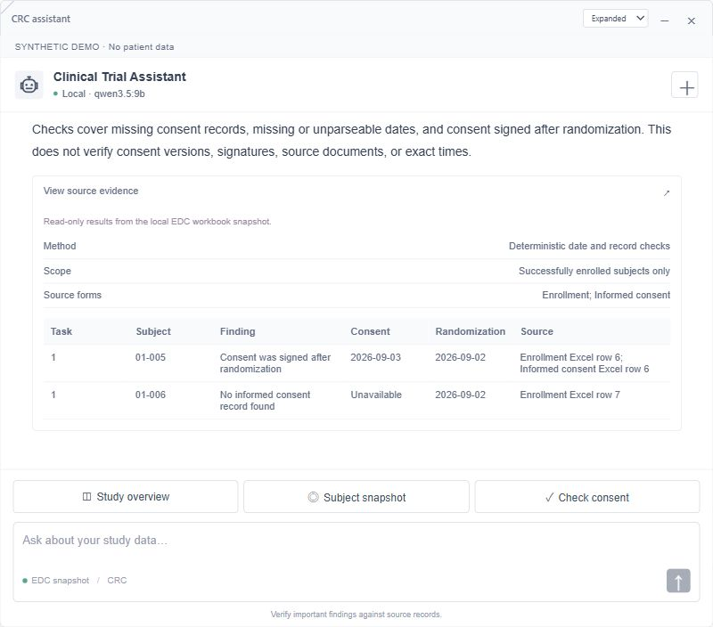
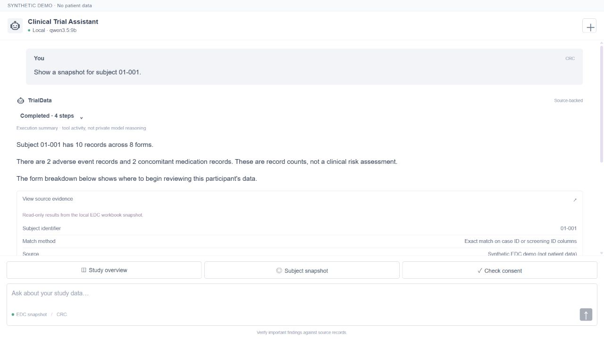
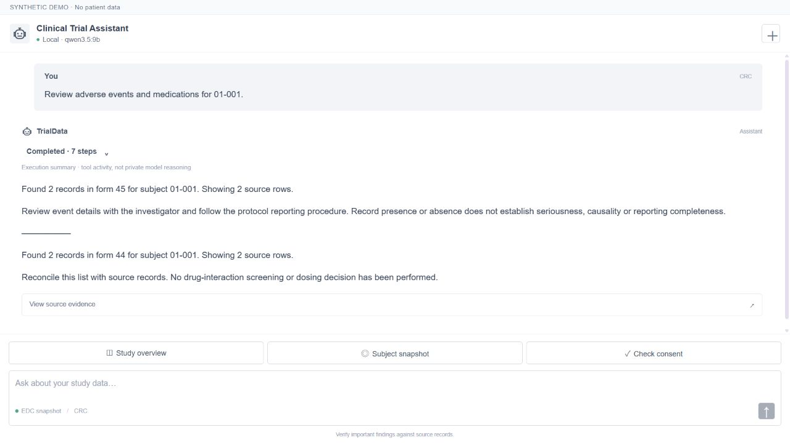
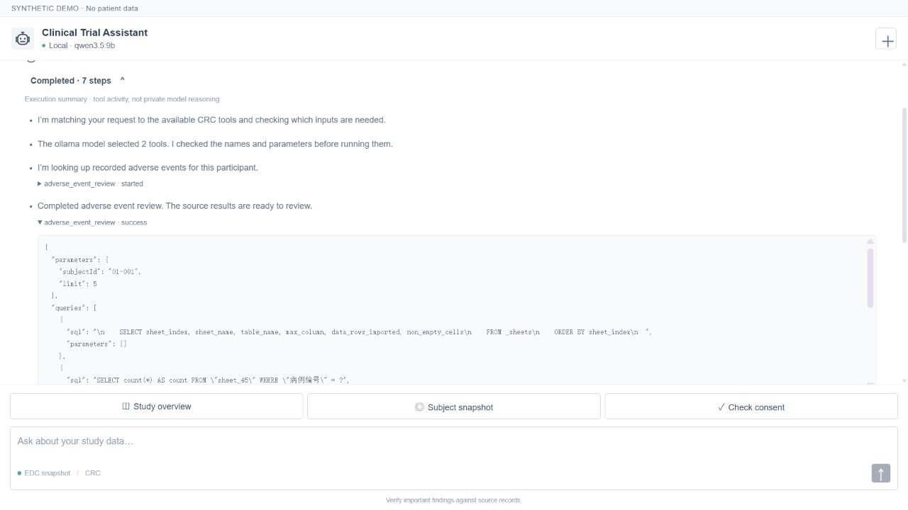
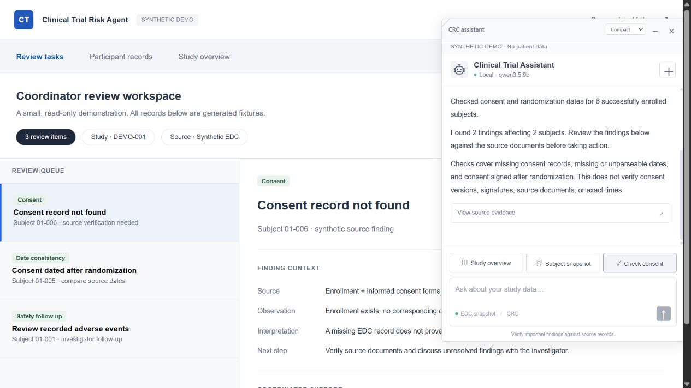

# Clinical Trial Risk Agent

A CRC assistant that turns a natural-language request into validated, read-only clinical-data tools, then shows the source results and the actions actually taken.

**React · Node.js · SQLite · API models / local Qwen 3.5 9B**

This portfolio demo uses **entirely synthetic records**. It is a coordinator review aid, not a clinically validated system or an autonomous medical decision-maker.

## See it work

These are unretouched screenshots of the running application, not mockups. The fixture contains 6 synthetic participants, 46 form slots and 41 imported records. Empty forms are deliberately not labeled overdue.

### 1. Review consent documentation

Choose **Check consent**. The program finds two synthetic review items among six enrolled subjects: a consent date after randomization and a missing consent row. Each finding includes its source row reference. A missing EDC record is not presented as proof that consent was not obtained.



### 2. Prepare a participant review

Choose **Subject snapshot → 01-001**. Exact-ID aggregation returns 10 records across 8 forms, including 2 adverse-event records and 2 concomitant medication records. Counts describe stored records, not clinical risk.



### 3. Let the model compose tools

Ask **“Review adverse events and medications for 01-001.”** In this recorded run, local `qwen3.5:9b` selected `adverse_event_review` and `medication_review`. The executed queries returned two records from each form. Numeric results are rendered directly from functions, rather than rewritten by another model call.



### 4. Inspect what happened

The expandable execution summary shows the actual tool names, parameters, status and SQL bind values. Collapsed mode rotates one readable bullet at a time; expanded mode keeps receiving the complete history. It closes automatically when the presentation finishes and can be reopened.

The **Thinking** label represents an execution summary, not disclosure of private model reasoning. Fast tools are honestly labeled **Reviewing completed steps** while the UI finishes its reading queue.



### 5. Embed it in a workspace

The blue robot can be dragged, remembers its location and opens a resizable conversation. The standalone package includes a small synthetic review workspace. The private historical platform and its archived clinical snapshots are intentionally excluded from this public repository.



## Run locally

Requirements: Node.js **22.13+** (tested on 24.22.1) and a package manager. Quick actions run without a model. Natural-language tool selection needs either Ollama or an API connection.

```bash
git clone https://github.com/ericli-88/Clinical-Trial-Risk-Agent.git
cd Clinical-Trial-Risk-Agent
npm install
npm run demo:data
npm run build
npm start
```

For lockfile-reproducible installation, use `pnpm install --frozen-lockfile` instead of `npm install`. The tested lockfile uses pnpm 11.25.0.

Open **http://127.0.0.1:3002/** for the workspace, or **http://127.0.0.1:3002/assistant/** for full-page chat. This port is separate from the existing private dashboard on 8080.

Windows: after installing dependencies, `powershell -File scripts/Start-Agent.ps1` also builds and starts the demo. It can find the bundled Codex Node runtime if `node` is absent from PATH.

### Model configuration

Copy `.env.example` to `.env` if configuration is needed. With no API key, `AI_PROVIDER=auto` selects local `qwen3.5:9b`.

```bash
ollama pull qwen3.5:9b
ollama serve
```

If Ollama is already running, a second `serve` process is unnecessary. The model is a separate installation and is not bundled in the repository.

To use the remote adapter, set `API_KEY` and leave `AI_PROVIDER=auto`; remote failures fall back locally. Set `AI_PROVIDER=ollama` to force local execution. The implemented remote adapter uses DeepSeek's chat-completions endpoint; it is not a universal provider adapter. The header reports the active provider. If planning fails, a limited rules fallback is explicitly identified in the log. Quick actions bypass model planning.

Only the question and tool catalog are sent to the planning model; source rows are not needed for planning. Do not put private clinical details into remote-model questions without the appropriate organizational authorization.

## Tasks and architecture

Ten implemented tools cover overview, participant snapshot, consent checks, bounded source retrieval, adverse-event review, medication review, blank-field checks, explicitly supplied visit windows, unsent query drafts and monitoring preparation.

Read the [CRC research, atom contracts and SQL examples](docs/CRC-ATOMS.md). It also separates planned extensions from working features.

```text
Question → API/local model → bounded JSON plan → argument validation
                                                    ↓
Quick action ───────────────────────────────→ read-only tools
                                                    ↓
                                   evidence + real execution events
                                                    ↓
                              source-backed summary + expandable log
```

The model can compose independent calls and select a predefined composite tool. The current implementation does not support arbitrary dependency graphs or conversational references such as “that patient”; provide the subject ID in each request.

## What evolved

The project moved from a broad multi-role chatbot to an embedded CRC workflow after direct UI feedback. Data verification exposed misleading row-limit counts and imported headers masquerading as IDs. The implementation now separates aggregate counts from displayed records, validates exact identifiers, and exposes actual tool execution. A complex multi-model draft/checker path was replaced in this interface by one bounded planner and deterministic summaries.

The key tradeoff is less open-ended autonomy in exchange for reproducibility and explicit failure boundaries. The [architecture evolution and interview narrative](docs/ARCHITECTURE-EVOLUTION.md) documents the failures, feedback, changes and remaining limitations without claiming production outcomes.

## Verification

```bash
npm test
# While the synthetic server and local model are running:
node scripts/evaluate-live.mjs
```

- **21 automated tests** cover tool validation, exact filters, bounded reads, injection rejection, calendar boundaries, parameter provenance, unsent drafts, SQL tracing, SSE ordering, provider fallback, evaluation-suite integrity and scoring behavior.
- **4 live development smoke cases** passed: consent, compound AE + medication review, visit window, and blank-field count. The three natural-language cases used Ollama model selection, not fallback rules. Recorded inputs, outputs and events are in [live-results.json](docs/evaluation/live-results.json).
- These are development checks, not a held-out accuracy benchmark, clinical validation or a time-savings study.

### Fifty diverse model evaluation scenarios

The [50-case evaluation suite](eval/README.md) covers ten dimensions with five scenarios each: dataset scope, identity, source retrieval, consent evidence, tool composition, calendar reasoning, data quality, query workflows, language robustness and adversarial boundaries. Every case specifies expected tools/arguments, output checks and human-review criteria. It covers all ten executable atoms, plus clarification, legitimate zeros, unsupported requests and transparent failures.

```bash
npm run eval:model
npm run eval:docs
```

The first complete local-Qwen run recorded **32/50 model-mediated automatic passes** and **36/50 system automatic passes**. The distinction excludes rules fallback from model success. Human-quality reviews remain pending. These are development-suite results, not held-out model accuracy.

Read the [50 prompts and expectations](docs/evaluation/CASE-CATALOG.md), [full baseline summary](docs/evaluation/MODEL-BASELINE.md), [recorded outputs](docs/evaluation/model-50-results.json) and [failure analysis, including a likely scoring false negative](docs/evaluation/BASELINE-REVIEW.md). Failures are preserved; the Agent was not tuned to make this baseline pass.

## Data and integration boundaries

The SQLite connection is read-only. Tools cannot execute model-generated SQL, send messages, modify EDC, submit safety reports or make treatment decisions. Visit windows require supplied dates and rules. Consent checks do not establish signature validity, approved version, exact time or source-document completeness.

The adapter follows an explicit 46-form workbook contract. To use another export, validate its metadata mapping first. The optional `scripts/import_edc_workbook.py` imports a compatible private workbook; it needs Python and `openpyxl`. Set `EDC_DB_PATH` in the ignored `.env` to the resulting local SQLite file. Never commit source workbooks, import reports, databases, credentials or private screenshots.

The server binds to loopback and has no production authentication or multi-tenant controls. It is intended for local use. Provider calls have timeouts and are aborted when the client disconnects. This repository deliberately excludes the private original platform and clinical data.

## Layout

```text
src/ui/                 React chat and progressive execution log
src/server/crcAgent.js   Tool catalog, validated planner and SSE route
src/server/crcWorkspace.js   Aggregate counts and consent checks
src/server/data_access/  Read-only workbook adapter
src/server/model_client/    API/local model adapter and fallback
src/workspace/          Synthetic host workspace and draggable widget
scripts/                Fixture generation, evaluation and startup
docs/                   Research, architecture, real captures and results
```
