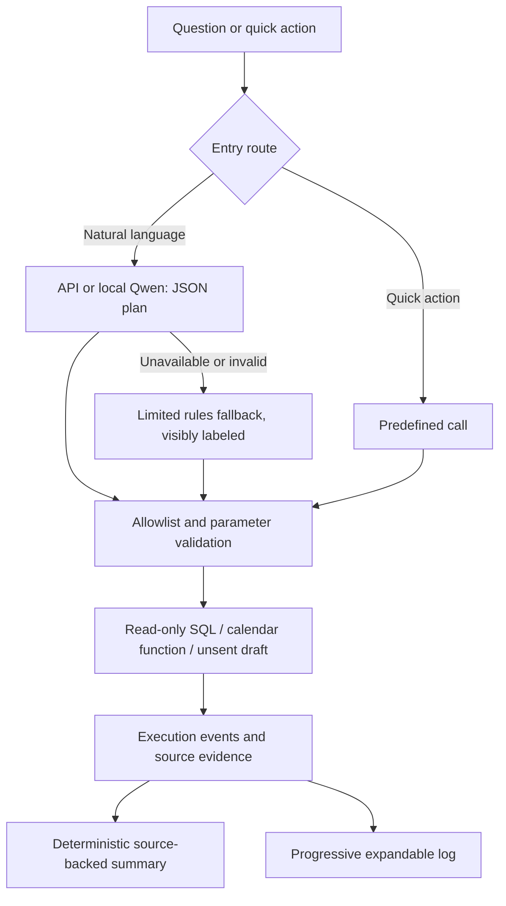

# Architecture evolution and interview narrative

## Problem

A CRC needs specific follow-up work from EDC observations without confusing a missing record with a confirmed protocol deviation. A plausible answer is insufficient when its count, participant filter or evidence is wrong.

## What changed and why

| Stage | Observed failure or feedback | Change | Tradeoff |
|---|---|---|---|
| General multi-role chatbot | User wanted a CRC tool, not four role cards | Scope UI and vocabulary to CRC | Less breadth, clearer workflow |
| Decorative dashboard | User rejected the design, then approved the restored original | Preserve the private host dashboard locally; embed chat | Host and agent remain separate data contexts |
| Assistant bar | User wanted a draggable robot; neutral icon was hard to find | Small blue launcher, position memory, resizable chat | Discoverable without a permanent toolbar |
| Generic retrieval | A row cap could undercount; repeated headers appeared as IDs | Exact-ID aggregation, validation, total vs shown rows | More import-specific adapter work |
| API dependence | Invalid remote credentials caused failures | API mode with local Qwen fallback | Local model availability and latency matter |
| Complex planner/draft/checker flow | Multiple model calls complicated latency and observability | One bounded planning call; deterministic tools and summaries | Less flexible prose; clearer reproducibility |
| Hidden execution | User requested tools, parameters and progress | Actual SSE execution summaries and expandable history | Deliberate reading delay after fast tools finish |
| Portfolio distribution | Private records should not enter GitHub | Clean standalone package, synthetic fixture, real UI captures | Demo background differs from private historical dashboard |

These are development observations and user feedback. They are not claims about clinical deployment, formal user studies or measured time savings.

## Current request path

The final summary does not need a second model call. Validation rejects unknown tools, extra parameters, unmentioned subject IDs, invented dates/windows/findings, invalid dates and unbounded limits. It does not prove semantic intent correctness. Human review and further evaluations remain necessary.

## Thinking contract

“Thinking” is a progress label for actual routing and execution summaries, not private model reasoning. Events have IDs and timestamps. Tool records contain names, parameters, status, runtime and actual SQL/bind values when SQL ran.

Collapsed mode shows one bullet at a time for about 2.6 seconds. Expanded mode shows every event received so far, including later events while work continues. The server never sleeps to simulate work. When computation finishes quickly, the UI says “Reviewing completed steps” while completing the presentation queue. The result then appears and the history collapses; it can be reopened. This reading delay is not model thinking time.

## Interview answer

> I started with a general EDC chatbot, but learned that generating a plausible answer and completing a coordinator task are different problems. User feedback narrowed it to CRC work and pushed the assistant into the existing dashboard. Verification showed that bounded retrieval could produce misleading participant counts, so I separated aggregation from displayed rows and kept exact identifier matching. I then simplified the architecture: the model proposes tools, but validated read-only functions produce the facts and numeric summary. Execution summaries let users see what was actually checked. The tradeoff is less open-ended autonomy, but clearer failure modes and a reproducible demo. Next I would evaluate tool selection across paraphrases and schema variations before considering write actions or production integration.

## Evaluation limits

Tests cover exact-match filtering, bounded reads, injection rejection, dates, unknown fields/IDs, draft provenance, SQL logs and provider fallback. A live local-Qwen compound request is captured separately. Screenshots show real interactions with synthetic fixtures. There is no clinical validation or deployment benchmark.

Next: held-out paraphrases, missing-input clarification, misleading user instructions, schema drift, session privacy and clinician review of wording. Provider requests have a timeout. Client disconnects abort the upstream planning request and prevent subsequent tool execution.

## First broader development evaluation

A subsequent [50-case suite](../eval/README.md) now tests ten dimensions against the unmodified Agent. The first recorded Qwen run passed 32/50 strict model-mediated automatic checks and 36/50 system checks when successful fallback is included. Cases revealed redundant retrieval, incorrect display limits, misunderstood evidence capabilities and unrelated fallback actions. One refusal appears to be a scoring false negative. See the [recorded baseline](evaluation/MODEL-BASELINE.md) and [developer review](evaluation/BASELINE-REVIEW.md). This adds measured development evidence to the evolution story without claiming held-out accuracy or clinical validation.
