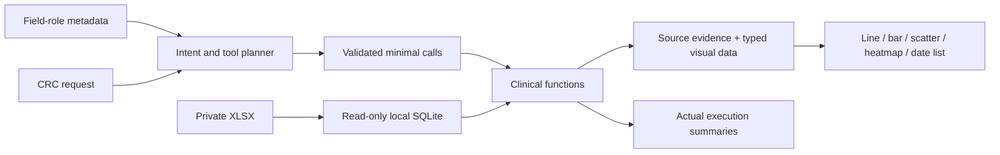

# Clinical workbook: CRC workflows, atoms and visualization contracts

The catalog additionally includes five [data-science chart tools](SCIENCE-VISUALIZATIONS.md), bringing the total to 30.

The private workbook is the operating data source, not a prop behind a synthetic chatbot. Its original Excel rows are imported into a local read-only SQLite adapter. The public repository includes the adapter and independently generated fixtures, never participant records or private screenshots.

The workbook contract covers screening, consent, enrollment, visits, laboratory observations, treatment administration, drug concentrations/rescue medication, safety, lesion measurements and follow-up forms. A row may represent a lab analyte, physical-examination item or medication entry; **row counts are not participant counts**. The implementation supports the 46-form import contract and maps original column headers through a semantic layer.

## What CRC tasks require

| Coordinator task | Evidence required | Executable tool | Display |
|---|---|---|---|
| Find actual source fields/analytes | `_sheets`, `_columns`, distinct analyte labels | `schema_catalog` | Field table |
| Review stored enrollment coverage | Enrollment status / site | `enrollment_summary` | Category-count bars |
| Prepare one participant's chronology | Consent, randomization, visits, treatment and event dates | `participant_timeline` | Dated event list |
| Review a laboratory marker over visits | Exact ID, lab form, analyte, collection dates, values, units | `lab_trend` | Separate line panels per recorded unit |
| Review values outside source reference limits | Value and that row's reference bounds | `lab_reference_review` | Flag-count bars and source table |
| Review MTX concentrations | Relative-hour label, visit/cycle, concentration and qualified-value status | `mtx_concentration_review` | Per-cycle line/scatter series |
| Corroborate MTX and rescue records | Exact participant and optional exact visit in both forms | `mtx_rescue_review` | Separate source streams and rescue dates |
| Review induction treatment | Regimen and oral-study-drug records | `treatment_history` | Dated records; unknown ends preserved |
| Prepare safety follow-up | Event term, onset/end, recorded CTCAE grade, SAE flag | `ae_followup_review` | Recorded-grade bars or event timeline |
| Reconcile concomitant medication timing | Start/end dates and ongoing status | `medication_timeline` | Source intervals without invented end dates |
| Review eligibility documentation | Recorded checklist responses | `eligibility_record_review` | Criterion/response table |
| Understand follow-up availability | Consolidation, response, PFS, OS, death and completion forms | `followup_coverage` | Stored-row counts |
| See existing visit/form coverage | Exact participant + visit + form grouping | `visit_form_matrix` | Record-count heatmap |
| Review lesion measurements | Stored per-lesion product, site and assessment date | `lesion_measurement_review` | Scatter plot; no inferred longitudinal lesion matching |
| Inspect actual response documentation | Stored result/date/basis and missing values | `response_assessment_review` | Source table |

These 15 tools supplement the original 10 tools: overview, subject snapshot, consent, bounded form/AE/medication retrieval, blank fields, supplied visit-window arithmetic, unsent query drafts and monitor preparation. The complete catalog is available from `/api/crc/atoms`.

## Design: four separate layers

1. **Source adapter.** Preserve original XLSX, metadata, imported values and `__source_row`. Select table and column identifiers from metadata; quote identifiers and bind values. Exact subject/visit predicates run in SQL. The database connection is read-only.
2. **Clinical functions.** Parse dates and numeric observations conservatively; normalize only unit typography. Perform grouping, reference-bound comparisons or predefined cross-form retrieval. Retain qualified values, missing fields and provenance. Each function returns an evidence table and typed visual data.
3. **Intent and planning.** The model sees the request, registered function contracts and actual field-role metadata. It chooses the minimal tool set and parameters. It never receives participant records for planning, authors SQL or invents chart numbers. Code validates names, arguments, subject-ID provenance and display compatibility.
4. **Presentation.** Chart functions own numeric/date/categorical semantics. React draws the typed data using ordinary SVG, tables and date lists. Tool and chart-building events feed the expandable execution log. Changing the display to `table` suppresses the chart without changing the query or facts.



## Planner prompt and task selection

The actual prompt is versioned in [clinicalPlanner.js](../src/server/clinicalPlanner.js), not just described in this document. Field aliases, tool contracts and query/aggregation rules are implemented in [clinicalTools.js](../src/server/clinicalTools.js).

Planning decisions distinguish:

- **Operation:** lookup, count, source check, trend, timeline, existing-record matrix or unsent draft.
- **Scope:** exact participant, form/domain, analyte/approved alias, optional exact visit.
- **Prerequisites:** date/window inputs, actual headers and available fields. Missing prerequisites trigger clarification rather than invented values.
- **Composition:** a request for creatinine and MTX can select `lab_trend` plus `mtx_concentration_review`. A request for MTX plus rescue records can use the predefined composite tool rather than an unbounded join.
- **Output:** compatible `display` values are declared per tool; `auto` is the default. Unsupported chart conversions fail validation.
- **Boundary:** a prohibited request or invalid model plan must not be replaced with an unrelated participant lookup. Runtime keyword fallback has been removed; explicit quick actions remain available.

English tool instructions support Chinese and English questions. Analyte aliases include creatinine, WBC, platelets, hemoglobin, neutrophils, ALT, AST, eGFR, albumin and bilirubin. Unrecognized labels fail explicitly rather than selecting the nearest string.

## Data rules that change the answer

- Text numeric `0` is a valid zero; blank or “not done” is not zero. `<0.1` retains its qualifier and is not plotted as exactly `0.1`.
- Impossible dates such as February 30 are not silently rolled into March. Unparseable dates stay visible in source evidence and do not enter date plots.
- Different units get separate panels. No implicit mass/concentration conversion or averaging is performed. Missing-unit lab values stay in the table and are excluded from trend plots.
- Reference flags use the row's recorded bounds. Missing or reversed bounds are exposed. Flags do not become CTCAE grades, diagnoses or treatment decisions.
- MTX `0h/24h/48h/72h` observations differ from rows summarizing days until a concentration threshold. Summary-day rows are not converted into hourly concentration points. Cycles are not concatenated into one curve.
- MTX and rescue forms are retrieved separately by exact subject/optional visit. Temporal proximity is not a validated dose-to-sample link or a causal finding.
- An AE without a stored end date is not automatically labeled ongoing. Recorded grade and SAE status are reproduced; seriousness and causality are not inferred.
- A medication with an unknown end is not extended to today. Oral tablet counts do not establish adherence without a prescribed schedule and reconciliation rules.
- Checklist responses do not establish final eligibility. Arbitrary clinical criteria are not reinterpreted by a language model.
- Lesion products and already-stored visit totals are different quantities. Repeated total fields are not summed across lesion rows. Without stable lesion IDs, measurements are not connected as though they identify the same lesion.
- Blank outcome fields and empty PFS/OS forms do not support response rates, treatment failure claims, survival curves or comparisons between trial arms.
- A heatmap cell counts existing long-form rows, not expected visits. An approved schedule, anchors and exceptions are still needed for a completeness assessment.
- At most 100 result rows are shown, with the full matched count stated. Numeric charts and aggregate calculations use the full selected scope rather than just the displayed rows.

## Example CRC requests

```text
Show the creatinine trend for subject 01-001 from chemistry form 15.
Review the creatinine values against their stored reference limits.
Plot MTX concentrations for 01-001, keeping treatment cycles separate.
Review MTX observations and rescue-medication records for 01-001.
Show recorded CTCAE grades and SAE flags for 01-001.
Show an existing-records heatmap for forms 13, 15, 34 and 35 for 01-001.
Review the stored eligibility checklist for 01-001 without deciding eligibility.
Inspect the response assessment result and date for 01-001.
```

Use an identifier from the connected workbook. These examples also work with the synthetic fixture. This interface still uses self-contained requests rather than conversational “that participant” references.

## Private operation and reproducible public demo

```powershell
# A compatible private workbook; Node and Python/openpyxl are required.
.\scripts\Start-PrivateAgent.ps1 -Workbook "C:\private\study-export.xlsx" -Port 3002
```

The script creates a content-addressed local database under ignored `data/`, leaves the XLSX intact, defaults private planning to local Ollama and starts the app. To use an existing import, configure `EDC_DB_PATH` in the ignored `.env`. The source banner distinguishes private records from the synthetic demo. The private workspace replaces illustrative task cards with actual workbook coverage and consent findings.

```bash
# Rich synthetic fixture, independent of the historical 50-case fixture:
npm run build
npm run start:clinical
# Open http://127.0.0.1:3003/
npm run test:clinical
npm run eval:clinical
```

Private screenshots and verification outputs stay in ignored `temp/` or `data/`. Public clinical chart screenshots and the clinical smoke report use only generated fixture values. The earlier [50-case baseline](evaluation/MODEL-BASELINE.md) is preserved as a historical result for the earlier ten-tool planner; it is not a score for this expanded catalog.

## Research basis and limits

The design applies source traceability and accurate recording principles from [FDA E6(R3) Good Clinical Practice](https://www.fda.gov/regulatory-information/search-fda-guidance-documents/e6r3-good-clinical-practice-gcp). The separation of MTX observations, renal-function evidence and rescue records is informed by the [Cancer Care Ontario methotrexate monograph](https://www.cancercareontario.ca/en/drugformulary/drugs/monograph/44166/1000). These references do not supply this trial's approved visit windows, rescue doses, deviation definitions or adjudication rules. Those remain protocol-specific inputs and are not invented by the Agent.
