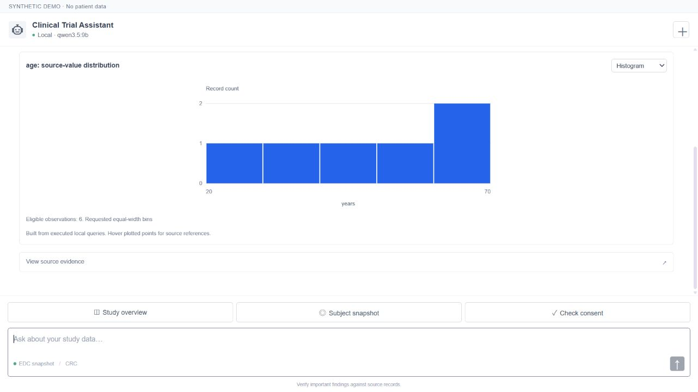
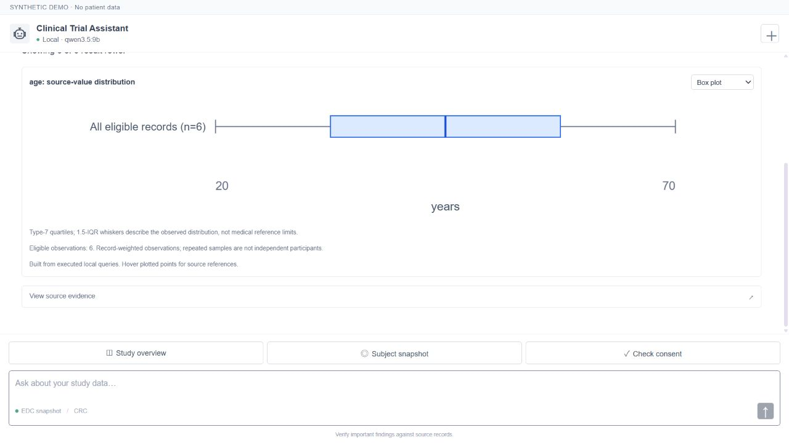
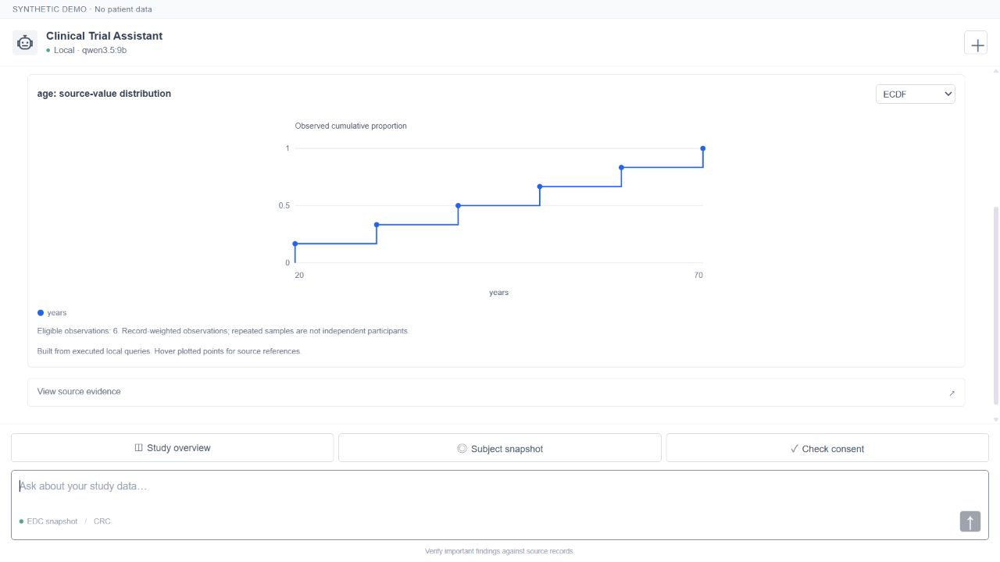
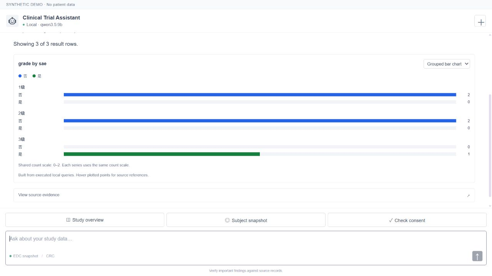
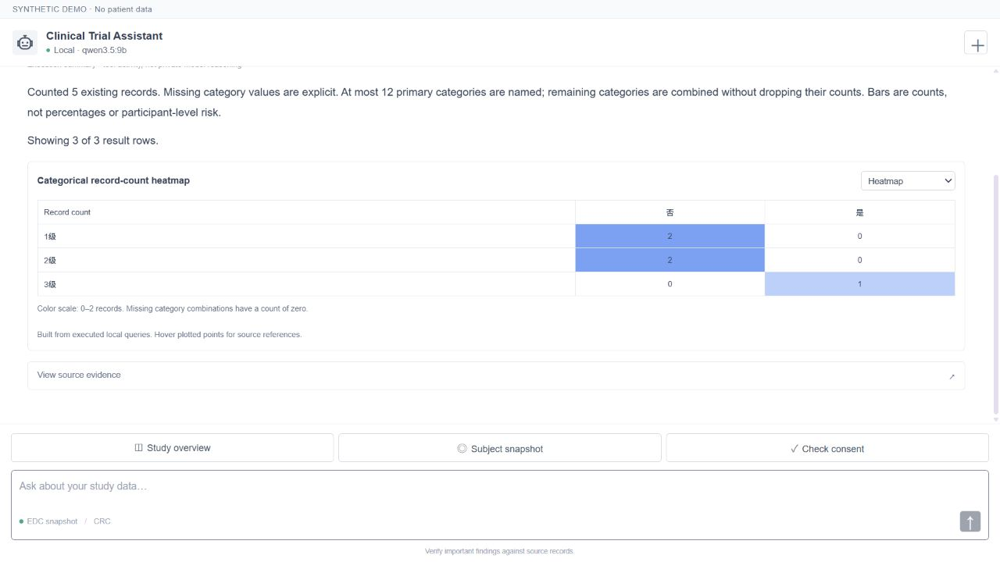

# Data-science chart tools

Charts are selected by the statistical question and data contract, not by giving every result the same time-series plot. The current registry contains 12 chart kinds, plus distinct count, missingness and correlation matrix semantics.

## Available visualizations

| Chart | Suitable data / question | Computation and boundary |
|---|---|---|
| Histogram | Distribution of one numeric variable | Explicit equal-width edges; automatic Freedman–Diaconis bins with Sturges fallback; last edge inclusive |
| Box plot | Median/spread, optionally by category | Type-7 quartiles, actual 1.5-IQR whiskers and observed outliers; outliers are descriptive, not clinical flags |
| Density / KDE | Smooth exploratory distribution | Gaussian kernel, robust Silverman bandwidth; requires at least five nonconstant eligible observations |
| ECDF | Fraction of observations at or below a value | Empirical steps and exact tie counts; not a fitted probability distribution |
| Scatter plot | Relationship between two numeric variables | Exact paired records; no automatic regression, significance or causality claim |
| Correlation heatmap | Relationships across 2–6 numeric variables | Pearson r on a common complete-case set; at least three pairs; constant/insufficient cells are `n/a` |
| Bar chart | Counts of categories | Count every selected source row; show missing labels and any aggregated “Other” bucket |
| Grouped bar chart | Counts for two categorical dimensions | Side-by-side series on a shared count scale |
| Stacked bar chart | Count composition for two categories | Raw counts; not silently normalized to 100% |
| Heatmap | Category counts, existing form records, or blank fractions | Measure-specific scales and labels; missingness cells include missing/total counts |
| Line chart | Ordered numeric observations | Preserve units, participant/visit scope and source references |
| Timeline | Recorded dates / medication intervals | Do not invent end dates or connect unrelated events as causal evidence |

No violin, PCA, t-SNE, regression, survival or inferential-test output is claimed as implemented. New recipes can be added when their required data and computation are implemented and tested.

## Registered functions

The catalog now contains **30 tools**: the previous 25 plus five data-science tools.

| Function | Required inputs | Optional controls | Default display |
|---|---|---|---|
| `numeric_distribution` | Form, numeric source field, source unit field or explicitly supplied unit | Subject, visit, group field, bins | Histogram; box when grouped |
| `lab_distribution` | Lab form and analyte | Subject, visit, visit/subject groups, bins | Histogram; box when grouped |
| `lab_relationship` | 2–6 `{formId, analyte, unit?}` variables | Exact subject/visit; unit selection when needed | Scatter for two variables, correlation matrix for more |
| `categorical_summary` | Form and categorical field | Second category, subject/visit, top-N | Bar; grouped bar when split |
| `data_missingness_map` | Form and 1–12 fields | Subject and grouping by visit/site | Blank-fraction heatmap |

`display` accepts only compatible kinds declared by the function. Unknown source columns are not guessed. `table` suppresses visual output while retaining the computation and source evidence.

Field-role aliases include `age`, `ageUnit`, `value`/`result`, `unit`, `grade`, `sae`, `site`, `visit` and `enrolled`. The schema tool exposes the actual mapped roles. Numeric identifier columns cannot be treated as measurements; names, free text and treatment arms are blocked as generic chart categories.

## Interactive chart switching

Each chart has a **Chart type** selector when several compatible views are available. Distribution results can switch between Histogram, Box plot, Density and ECDF without another model call or a different query. A clinical trend also exposes distribution views of the same eligible plotted observations; its distribution population is deliberately limited to those plotted points, unlike a distribution-only request that does not require dates.

Two-variable relationship results can switch between scatter and a correlation matrix. Two-category counts can switch between grouped bars, stacked count bars and a categorical heatmap. Missingness can switch between fractions in a heatmap and blank counts in a bar chart. The selector cannot coerce a categorical result into a numeric density plot.

## Pairing, units and denominators

- Different measurement units produce separate distribution panels. Unit typography may be normalized; no implicit unit conversion is done.
- Qualified values such as `<0.1`, unparseable values and missing units are excluded from numeric distributions and retained in the evidence table. Dates are unnecessary for a distribution, but are required for trend and relationship pairing.
- Relationship keys are **exact subject + visit + collection date**. Duplicated variable/key groups are omitted instead of being averaged or multiplied by a many-to-many join. Every variable in a correlation matrix uses the same complete-case record set.
- A variable with multiple units requires an explicit unit choice. A supplied unit label must be present in the user's request; otherwise use a source unit column. No automatic scale conversion is hidden in the chart.
- Repeated observations are record-weighted. A histogram sample count or correlation pair count is not a count of independent participants. No p-values, clinical risk probabilities or efficacy claims are generated.
- Missingness means stored blank cells divided by existing rows in a group. “Not done” and “not applicable” text is not automatically reclassified as blank. Entirely absent visits are outside this denominator.
- Automatic top-N categorical summaries aggregate remaining counts into an explicit Other category. Counts are not dropped to make the plot look cleaner.

## Planner and runtime contract

[clinicalPlanner.js](../src/server/clinicalPlanner.js) routes distribution, association, categorical comparison and missingness intents to the corresponding functions and preserves explicit chart requests. [scienceTools.js](../src/server/scienceTools.js) validates and prepares source data; [scienceCharts.js](../src/server/scienceCharts.js) computes the statistics; [ScienceCharts.jsx](../src/ui/ScienceCharts.jsx) renders the typed outputs.

An invalid JSON/argument plan can receive **one schema-correction attempt before participant data is queried**. Validation feedback is shown as an execution event. A second rejection stops the request; network failures are not retried through this schema-repair loop. Runtime source errors remain visible rather than triggering a broader query.

`GET /api/crc/charts` lists chart contracts. `GET /api/crc/atoms` lists functions and allowed display kinds. Chart numbers come from executed functions, not model-generated plotting code.

## Reproducible synthetic demo

```bash
npm run build
npm run start:science
# http://127.0.0.1:3004/assistant/
npm run test:science
npm run eval:science
```

The science fixture is separate from both the private workbook and earlier evaluation fixtures. It includes numeric distributions, mixed units, a qualified observation, missing values, duplicate pairing keys and recorded categorical grades. Only generated values appear in public screenshots and reports.

Examples:

```text
Show a histogram of age from form 4 with 5 bins, using the recorded age-unit field.
Show box plots of creatinine in form 15 grouped by visit, keeping units separate.
Show an ECDF of creatinine values from form 15.
Show a KDE of creatinine in form 15; explain any insufficient sample groups.
Show a Pearson heatmap of creatinine in μmol/L and ALT in U/L from form 15 for 01-001.
Show a stacked count bar chart of recorded CTCAE grade split by SAE status in form 45.
Show a missing-value heatmap for the result and unit fields in form 15, grouped by visit.
```

Tests independently verify histogram edge counts, quartiles/outliers, ECDF ties, KDE integral/availability, Pearson signs/constant cases, pairing exclusions, unit separation, category totals, missingness denominators and bounded model-plan repair. Live model smoke results are recorded separately and are not a held-out accuracy or clinical-validation claim.

## Real UI examples (synthetic records)

The following are screenshots of actual application interactions, not chart mockups. Every switch retains the executed source population.











## Development evaluation

The final [12-request model smoke run](evaluation/science-model-results.json) recorded 12/12 strict selected-tool/chart-kind/completion passes on the independent synthetic fixture. This is a development check, not held-out model accuracy or medical interpretation quality. The [initial run](evaluation/science-initial-results.json) recorded 9/12; [schema repair and explicit examples](evaluation/science-schema-repair-results.json) recorded 10/12. Earlier failures are retained.

The failures exposed variable-object schema mistakes, an unrecognized result-field role and dropped explicit unit selections. The fixes add a defined role alias, a maximum of one pre-query JSON/argument repair attempt, and rejection of plans that omit units explicitly specified for all requested variables. They do not change the source data, pairing rules, sample-size guards or expected chart kinds to make a failing result look successful.
